<p align="center">
  
</p>

<p align="center">
  <b>High-performance, constant-memory Excel (XLSX) writers for .NET, Rust, Python, Node.js, Go, Java and PHP, built for web services.</b>
</p>

<p align="center">
  
  
  
  
  
  
  
  <a href="LICENSE"></a>
</p>

<p align="center">
  <a href="dotnet/README.md">.NET</a> ·
  <a href="rust/README.md">Rust</a> ·
  <a href="python/README.md">Python</a> ·
  <a href="node/README.md">Node.js</a> ·
  <a href="go/README.md">Go</a> ·
  <a href="java/README.md">Java</a> ·
  <a href="php/README.md">PHP</a> ·
  <a href="#quick-look">Quick look</a> ·
  <a href="#features">Features</a> ·
  <a href="#roadmap">Roadmap</a>
</p>

---

Hypaxel writes `.xlsx` files as a forward-only stream. Each cell is serialized to UTF-8 XML the moment
it is written and compressed straight into a small buffer that flushes to the destination. Memory stays
flat whether you export 10 rows or 10 million, and the first bytes reach the HTTP client while your
query is still running.

```text
 rows ──▶ ▓▓▓ UTF-8 XML ──▶ ▒▒▒ deflate ──▶ ░░░ small buffer ──▶ HTTP response / file
          one cell at a time                 flushed as it fills
```

All implementations share one design. .NET, Rust, Go, Java and PHP are independent native engines
with no runtime dependencies; the Python and Node.js packages are thin, idiomatic layers over the
Rust core.

## At a glance

| | Package | Runs on | Engine | Web integration | 1M rows × 10 columns | Compared with |
| --- | --- | --- | --- | --- | ---: | --- |
| [.NET](dotnet/README.md) | `Hypaxel`, `Hypaxel.AspNetCore` | .NET 8, 9, 10, 11 | native | ASP.NET Core: `Results.Extensions.Excel(...)`, `this.Excel(...)` | ~0.8 s on .NET 9+ | ~20–25x faster than ClosedXML |
| [Rust](rust/README.md) | `hypaxel`, `hypaxel-axum` | Rust 1.85+ | native | axum: `Xlsx::from_records(...)`, `Xlsx::from_stream(...)` | ~0.73 s | ~11–14x faster than rust_xlsxwriter |
| [Python](python/README.md) | `hypaxel` | CPython 3.10+ | Rust core (PyO3) | FastAPI/Starlette `XlsxResponse`, Django, Flask | ~0.9 s | ~50x faster than XlsxWriter, ~95x faster than openpyxl |
| [Node.js](node/README.md) | `hypaxel` | Node.js 22+ | Rust core (napi-rs) | `stream()` for Express, Fastify, Koa; `webStream()` for Next.js, Hono | ~1.2 s | ~6x faster than ExcelJS's streaming writer |
| [Go](go/README.md) | `github.com/vensas/hypaxel/go` | Go 1.26+ | native | `hypaxelhttp.Handler`, `hypaxelhttp.Serve` | ~0.9 s | ~5–6x faster than excelize's `StreamWriter` |
| [Java](java/README.md) | `de.vensas:hypaxel` | Java 17+ | native | any `OutputStream`: Servlet, Spring `StreamingResponseBody` | ~1.2 s | ~2.5–3x faster than FastExcel, ~8–9x faster than Apache POI SXSSF |
| [PHP](php/README.md) | `vensas/hypaxel` | PHP 8.2+ | native | `Xlsx::download()`, Symfony `StreamedResponse`, Laravel `streamDownload()` | ~4.2 s (~2.9 s with JIT) | ~11x faster than OpenSpout, ~40x faster than PhpSpreadsheet |

Timings come from each implementation's own benchmark, run at different times and partly on
different machines, so compare each row with its "compared with" library, not the rows with each
other. Each README has the full tables, versions and how to reproduce them. None of the packages
is published to a registry yet.

## Quick look

**.NET / ASP.NET Core**

```csharp
app.MapGet("/orders.xlsx", (AppDb db) =>
    Results.Extensions.Excel(db.Orders.AsNoTracking().AsAsyncEnumerable(), "orders"));
```

**Python / FastAPI**

```python
@app.get("/orders.xlsx")
async def orders():
    return XlsxResponse(hypaxel.astream_records(fetch_orders()), filename="orders.xlsx")
```

**Node.js / Express**

```ts
app.get('/orders.xlsx', async (req, res) => {
  res.setHeader('Content-Type', CONTENT_TYPE)
  await pipeline(stream(db.orders.cursor()), res)
})
```

**Go / net/http**

```go
http.Handle("/orders.xlsx", hypaxelhttp.Handler("orders", func(r *http.Request, w *hypaxel.Writer) error {
	return hypaxel.WriteSheetSeq2(w, "Orders", db.Orders(r.Context()))
}))
```

**Java / Spring MVC**

```java
StreamingResponseBody body = out -> {
    try (XlsxWriter writer = XlsxWriter.create(out); Stream<Order> orders = repository.streamAll()) {
        writer.writeWorksheet("Orders", Order.class, orders);
    }
};
```

**PHP**

```php
Xlsx::download('orders.xlsx', $pdo->query('SELECT id, customer, amount FROM orders', PDO::FETCH_ASSOC));
```

**Rust / axum**

```rust
async fn orders(State(pool): State<PgPool>) -> Xlsx {
    Xlsx::from_stream("Orders", sqlx::query_as::<_, Order>("SELECT ...").fetch(&pool)).filename("orders.xlsx")
}
```

## Features

Shared by all three implementations (milestone 1: creating Excel files).

- **Values:** strings, numbers, booleans, dates/times/durations (1900 and 1904 systems), formulas, styled blanks
- **Styles:** fonts, fills, borders, alignment and number formats. Styles are de-duplicated
- **Worksheets:** multiple sheets, column widths, auto-fit columns, row heights, row grouping (outline levels), frozen panes, merged cells, auto filter, Excel tables, hidden sheets, tab colors
- **Strings:** inline (default, constant memory) or a shared string table
- **Compact output:** cell references are only written after gaps
- **Valid output:** checked against the Office Open XML schema validator and read back by independent readers
  (Open XML SDK, calamine, openpyxl, LibreOffice)

## Repository layout

```
dotnet/    .NET solution: src/, tests/, samples/, benchmarks/
rust/      Cargo workspace: hypaxel/, hypaxel-axum/
python/    PyO3 + maturin package over rust/hypaxel: src/ (bindings), hypaxel/ (Python API), tests/, benchmarks/
node/      napi-rs package over rust/hypaxel: src/ (bindings), ts/ (TypeScript API), test/, benchmarks/
go/        Go module: the library, hypaxelhttp/, and tests/ (nested module with read-back tests and benchmarks)
java/      Maven project: src/, benchmarks/ (separate project)
php/       Composer package: src/, tests/, benchmarks/, examples/
.github/   CI: one workflow per implementation, each triggered only by changes to its own code
```

## Roadmap

1. ✅ **Create Excel files** (this milestone)
2. Hyperlinks, data validation, conditional formatting, images, document properties
3. .NET: a source generator for object mapping (AOT-friendly). Rust: optional parallel compression.
   Python: an Arrow-native DataFrame path
4. Streaming readers
5. Read-modify-write for templates

## License

Licensed under the [Apache License, Version 2.0](LICENSE). Copyright 2026 vensas GmbH.
